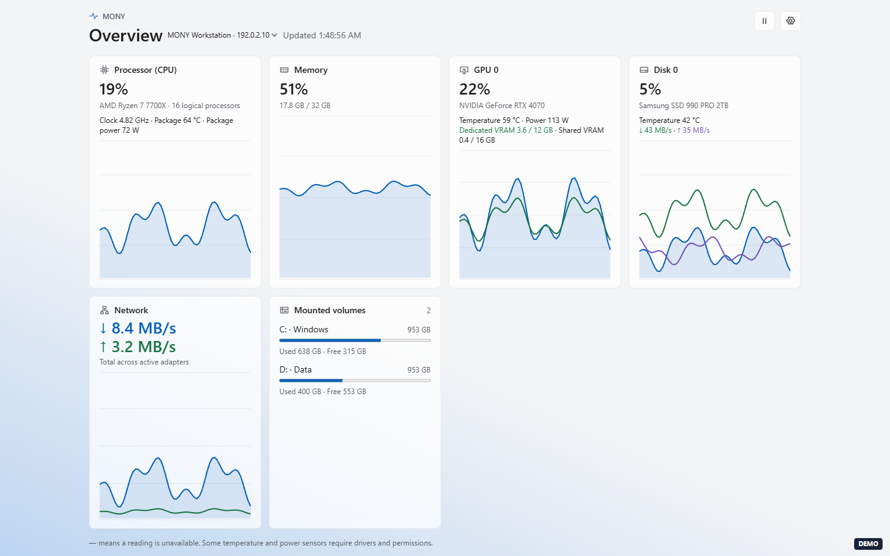
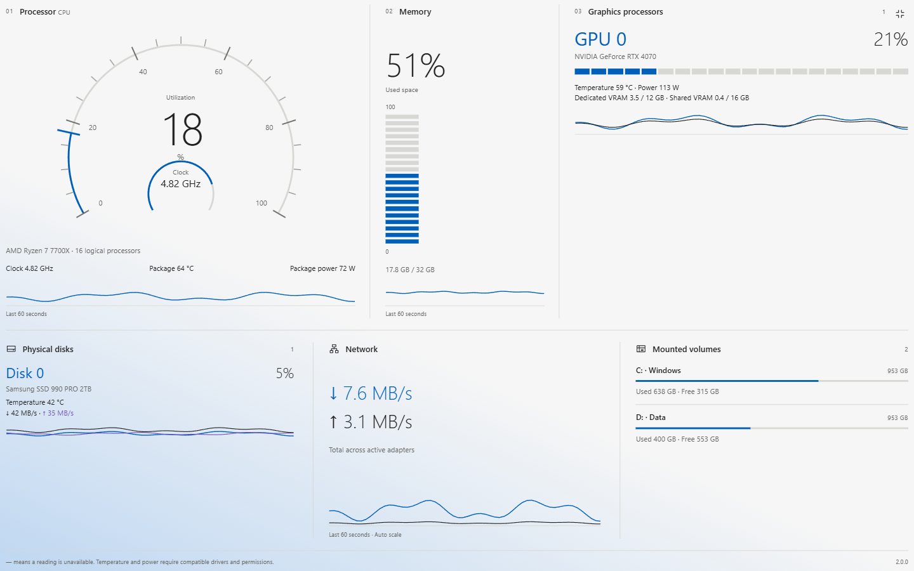

# MONY

English | [简体中文](README-CN.md)

Real-time performance monitoring for Windows 11 x64. Install `MONY-*-x64.msi` from the releases page. [Live demo](https://mony.ccjccj.eu.org/)

## Screenshots

The MONY web interface with simulated data.





## Features

- Samples the CPU, memory, individual GPUs, physical disks, network, and mounted volumes every second, with 60 seconds of history. Authorize PawnIO in the desktop app to read CPU temperature and package power.
- Supports tray operation, startup at sign-in, a full-screen dashboard, and Simplified Chinese and English. Connect to other MONY instances and switch the monitored computer. The web interface retrieves remote data through the local MONY instance.
- The web dashboard can be installed as a PWA. The overview, full-screen dashboard, target switching, and pause controls are available without signing in. Web settings support an optional password, a 24-hour cookie, and manual locking.
- Enable Windows and browser alerts independently for CPU or GPU temperature, low disk space, and remote disconnections. Alerts have a five-minute cooldown. Browser notifications can be muted for localhost or specific IP addresses.

## API

| Default port | Endpoint | Response |
| --- | --- | --- |
| 2727 | `GET /api/data` or `GET /` | Raw samples from the local computer |

The web and data services listen on localhost by default. Each has its own port and LAN access setting. When an API password is set, use HTTP Basic authentication with the username `pulse`. The web settings password is separate.

```powershell
curl.exe http://127.0.0.1:2727/api/data
curl.exe --user pulse http://127.0.0.1:2727/api/data
```

The response includes `version`, `computerName`, `computerIp`, `paused`, `cpuDetails`, and `sample`. The sample includes `time`, CPU and memory readings, `gpus`, `disks`, `volumes`, `download`, and `upload`. Before the first reading, `sample` is `null`. Unavailable readings are also `null`. Units are MHz, °C, W, bytes, bytes per second, and percentages from 0 to 100.

## Build

Install the .NET 10 SDK and WiX 5 on Windows, then run `.\tools\build-msi.ps1`. The MSI is written to `dist/`. The script verifies the SHA-256 of the [official PawnIO 2.2.0 installer](https://github.com/namazso/PawnIO.Setup/releases/tag/2.2.0) and downloads it if `installer/vendor/PawnIO_setup.exe` is missing.

[Changelog](CHANGELOG.md) · [Third-party licenses](installer/licenses)
